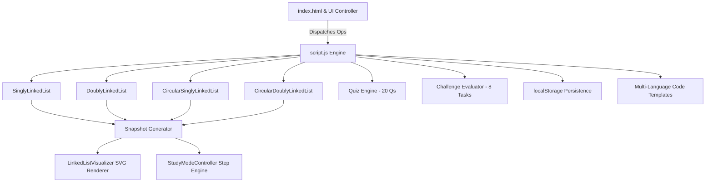

# DSA Simulator — Linked List Lab
### Interactive Data Structures Laboratory

A responsive, dark-navy educational simulator dedicated exclusively to **Linked Lists**. The primary simulator view has a top navigation bar, cyan-highlighted list-type tabs, a node visualization panel, and a right-side operations panel. Lessons, Study Mode, code references, quizzes, challenges, complexity comparison, and progress remain available through the secondary navigation.

---

## 🚀 Key Features

1. **4 Core Linked List Implementations**
   - **Singly Linked List (SLL):** Unidirectional node chain with `[DATA | NEXT]` cells terminating at `NULL`.
   - **Doubly Linked List (DLL):** Bidirectional node chain with `[PREV | DATA | NEXT]` cells, enabling $O(1)$ tail deletions and reverse traversals.
   - **Circular Singly Linked List (CSLL):** Continuous closed loop where `tail.next == HEAD`. Traversals are protected by cycle guards.
   - **Circular Doubly Linked List (CDLL):** Seamless dual-direction circular loop with `tail.next == HEAD` and `HEAD.prev == TAIL`.

2. **Interactive Visualizer Canvas**
   - Crisp SVG rendering of indexed nodes with distinct data and pointer compartments.
   - Dynamic arrows indicating forward (`next`), backward (`prev`), and circular loopback arcs.
   - Visual badges for `HEAD`, `TAIL`, `NULL`, `CURR`, and `NEW`.
   - Interactive Node Inspector: Click any node to inspect simulated heap addresses (`0x7ffee0...`), values, and pointer dereferences.

3. **Complete Operations Laboratory**
   - **Insert at Beginning:** $O(1)$ constant time relinking.
   - **Insert at End:** $O(1)$ with maintained tail pointer.
   - **Insert at Position:** $O(k)$ predecessor traversal with splice relinking.
   - **Delete from Beginning:** $O(1)$ head advance and memory reclamation.
   - **Delete from End:** $O(n)$ traversal for SLL/CSLL vs $O(1)$ for DLL/CDLL (The Delete Tail Paradox!).
   - **Delete at Position:** $O(k)$ predecessor traversal and node bypass.
   - **Search Value:** Linear search with cycle-safe termination.
   - **Update Value:** Modify existing node data in-place.
   - **Traverse:** Visit and highlight each node once; circular traversal is bounded by the stored list length.
   - **Reverse List:** In-place three-pointer pointer reversal for SLL and DLL.
   - **Random List Generator & Clear:** Quick sandbox reset tools.

4. **Step-by-Step Study Mode**
   - Choose any of the four list types and step through insert, delete, search, traverse, update, and supported reverse operations using discrete snapshots.
   - Stepper controls: First Step, Previous Step, Play/Pause, Next Step, Last Step, Reset.
   - Configurable animation speed: `0.5x`, `1.0x`, `1.5x`, `2.0x`.
   - Educational "What is happening" & "Why this pointer order matters" explanation cards.

5. **Multi-Language Code & Algorithm Viewer**
   - Algorithm steps and language-independent pseudocode for every simulator operation.
   - JavaScript implementations are read directly from the selected list type's model class.
   - C, C++, and Python reference examples are available for selected operations; unsupported combinations are called out rather than showing unrelated code.
   - Syntax-themed display with one-click clipboard copying.

6. **Complexity Comparison Matrix**
   - Time and auxiliary space comparison across SLL, DLL, CSLL, CDLL, and Arrays.
   - Color-coded badges: Green for $O(1)$, Amber for $O(n)$, Blue for $O(1)$ Auxiliary Space.
   - Pedagogical explanations of why specific operations require traversal.

7. **Interactive Quiz & Assessment**
   - 20 carefully curated questions across **Beginner**, **Intermediate**, and **Advanced** tiers.
   - Question formats: Multiple Choice (MCQ), True/False, Predict the Output, Pointer Tracing, and Find the Bug.
   - Instant feedback with educational explanations for correct and incorrect answers.
   - Scores tracked in `localStorage`.

8. **Practice Challenge Mode**
   - 8 Interactive challenges with automated verification:
     1. *Insert at Position 3*
     2. *Delete a Specified Value*
     3. *Reverse a Singly Linked List*
     4. *Find the Middle Node (Tortoise & Hare)*
     5. *Verify Circular List Linkage*
     6. *Doubly Linked List Two-Way Deletion*
     7. *Detect a Cycle (Floyd's algorithm)*
     8. *Merge Two Sorted Lists*
   - Multi-tier hint system (up to 3 hints per challenge) before solution verification.

9. **Progress Dashboard**
   - Tracks lessons read, operations executed, quiz accuracy, and solved challenges.
   - Persisted across sessions via browser `localStorage` with a reset option.

---

## 📁 Project Folder Structure

```
Dsap simulator/
├── index.html              # Main educational web application interface
├── style.css               # Responsive dark-navy lab UI with cyan/purple accents
├── script.js               # Unified engine: Models, SVG Visualizer, Study Mode, Quiz, Challenges, Storage
├── test/
│   ├── tests.js            # Automated test suite (73 unit tests) runnable via Node.js or browser
│   └── test_runner.html    # Browser-based test runner interface
├── backend/
│   ├── linked_list.py      # Companion Python reference implementations for all 4 list types
│   ├── stack.py            # Bounded stack reference with JSON operation snapshots
│   └── queue.py            # Bounded queue reference with JSON operation snapshots
├── server.py               # Optional Python HTTP server (python server.py)
├── server.js               # Optional Node.js HTTP server (node server.js)
└── README.md               # Complete project documentation and guide
```

---

## 🛠️ Setup and Execution Instructions

### Primary: Run with Python
Use the Python server as the main entry point. It serves the browser simulator and its assets from the project directory; no packages are required.
```bash
python server.py
```
Open [http://localhost:8080](http://localhost:8080) in your browser.

### Run from VS Code
Press **F5** and choose **Launch Chrome against localhost**. VS Code starts the Python server before opening the simulator at `http://localhost:8080`.

Python reference implementations for linked lists, stacks, and queues are in `backend/` and can also be run directly:
```bash
python backend/linked_list.py
python backend/stack.py
python backend/queue.py
```

### Alternative: Direct Browser Launch
Open `index.html` in Chrome, Edge, Firefox, or Safari to run the browser simulator without starting a server.

### Alternative: Local HTTP Server (Node.js)
```bash
node server.js
```
Open [http://localhost:8080](http://localhost:8080) in your browser.

---

## 🧪 Automated Testing & Verification

The project includes an automated test suite with **73 unit tests** covering all 4 linked list types:
- Singly Linked List: Insert (beg/end/pos), Delete (beg/end/pos), Search, Update, Reverse, Empty boundaries.
- Doubly Linked List: Bidirectional integrity, Prev/Next pointer updates, $O(1)$ tail deletion, In-place reversal.
- Circular Singly: Single-node self-loop, Tail loopback to head, Cycle-safe search traversal, Boundary deletion.
- Circular Doubly: Bidirectional loop integrity (`tail.next == head` and `head.prev == tail`), Outer and inner boundary relinking.

### Running Tests in Node.js
```bash
node test/tests.js
```
**Expected Output:**
```
Running Linked List Simulator Test Suite...
  ✓ SLL: Initialized empty
  ✓ SLL: InsertEnd creates [10, 20, 30]
  ✓ SLL: Head is 10, Tail is 30, Length is 3
  ...
  ✓ CDLL: Inner links intact
  ✓ CDLL: Outer circular links intact
  ✓ CDLL: Emptied list has null pointers

Test Summary: 73 Passed, 0 Failed out of 73 tests.
```

### Running Tests in Browser
Open `test/test_runner.html` directly in any browser to execute the tests visually.

### Running Python Reference Tests
```bash
python backend/linked_list.py
```
**Expected Output:**
```
Testing Python Linked List Reference Implementations...
  [OK] SinglyLinkedList passed
  [OK] DoublyLinkedList passed
  [OK] CircularSinglyLinkedList passed
  [OK] CircularDoublyLinkedList passed
All Python backend reference tests passed successfully!
```

### Running Python Stack and Queue Examples
Each script prints one JSON record per operation, including the returned result
and the complete state after that operation. Capacity overflow is reported as
`false` without changing the stored values.

```bash
python backend/stack.py
python backend/queue.py
```

---

## 🏛️ Application Architecture



### Component Breakdown
1. **Data Structure Models (`SinglyLinkedList`, `DoublyLinkedList`, `CircularSinglyLinkedList`, `CircularDoublyLinkedList`)**:
   - Pure OOP classes maintaining pointers (`head`, `tail`, `length`).
   - Every operation generates a history of algorithmic steps `{ title, description, highlightUid, codeLine, action }` for visualization.
2. **Visualizer Engine (`LinkedListVisualizer`)**:
   - Computes responsive SVG coordinate layouts.
   - Renders node compartments (`DATA`, `NEXT` for SLL/CSLL; `PREV`, `DATA`, `NEXT` for DLL/CDLL).
   - Generates forward arrows, backward arrows, and smooth cubic bezier curved paths for circular loopbacks.
3. **Study Mode Controller (`StudyModeController`)**:
   - Manages playback state, timer intervals, speed factors, step indexes, per-step structure snapshots, and highlighted pseudocode lines.
4. **Interactive UI (`SimulatorUI`)**:
   - Handles the responsive top navigation, view switching without reload, list-type tabs, presets, toasts, modals, inputs, challenge actions, and localStorage-backed lesson, quiz, and challenge progress.

---

## 📖 Sample Usage Walkthrough

1. **Exploring the Interactive Simulator:**
   - Choose a list type from the top navigation, such as **Doubly Linked**.
   - Enter `77` in the Value field and choose **At Beginning** in the right-side operations panel. Watch the `HEAD` badge and bidirectional links update.
   - Click on any node to open the **Node Inspector**, revealing its simulated heap memory address (`0x7ffee...`) and pointer references.

2. **Learning Step-by-Step in Study Mode:**
   - Click **"Study Mode"** in the learning navigation.
   - Choose a list type and operation (for example, Singly Linked List → Reverse), then click **"Load Guided Demo"**.
   - Use **Previous Step**, **Next Step**, or **Play** to follow the changing structure and highlighted pseudocode; check the complexity panel for time and auxiliary space.

3. **Inspecting Code Across Languages:**
   - Click **"Code"** in the learning navigation.
   - Select `Doubly Linked List` and `Delete from End`.
   - Click through **Pseudocode**, **JavaScript**, **C**, **C++**, and **Python** to contrast pointer dereferencing (`->`, `free`, `delete`, `nullptr`).
   - Click **"📋 Copy Code"** to copy the implementation for lab assignments.

4. **Solving Practice Challenges:**
   - Click **"Challenges"** in the learning navigation.
   - Select **"Challenge 3: Reverse Singly List"**.
   - Use the playground controls to invert the list, click **"💡 Hint"** if needed, then click **"Check Solution"** to verify your answer and unlock the completion badge.
   - Try **Detect a Cycle** to run Floyd's slow/fast-pointer check, or **Merge Two Sorted Lists** to relink the two displayed sorted inputs.

5. **Assessing Knowledge in Quiz Mode:**
   - Click **"Quiz"** in the learning navigation.
   - Filter by **Intermediate** or **Advanced**.
   - Select an answer to see instant color-coded feedback and detailed technical explanations.
   - Check your progress on the **Progress Dashboard**.

### Smoke Test Checklist
- Insert at position 3 into `[10, 20, 30, 40, 50]` with value `99` → `[10, 20, 30, 99, 40, 50]`.
- Delete index 2 from `[5, 12, 99, 25, 40]` → `[5, 12, 25, 40]`.
- Reverse `[1, 2, 3, 4, 5]` → `[5, 4, 3, 2, 1]`, with HEAD and TAIL exchanged.
- Search for `30` in `[10, 20, 30, 40, 50]` → found at index 2.
- Detect a cycle in a circular list → slow and fast pointers meet.
- Merge `[1, 3, 5]` and `[2, 4, 6]` → `[1, 2, 3, 4, 5, 6]`.

---

## 🔮 Suggested Future Enhancements

1. **Skip Lists:** Add an advanced multi-level skip list variant for $O(\log n)$ search exploration.
2. **Memory Layout Visualizer:** An interactive heap memory block view showing fragmentation and pointer indirection.
3. **Interactive Code Editor:** An in-browser sandboxed JavaScript code editor allowing students to write their own pointer manipulation code and run it directly against the visualizer.
4. **Dark / Light Theme Toggle:** Provide a full dark-mode palette switcher for the main workspace.

---

## 📄 License
This project is open-source educational software distributed under the MIT License.
